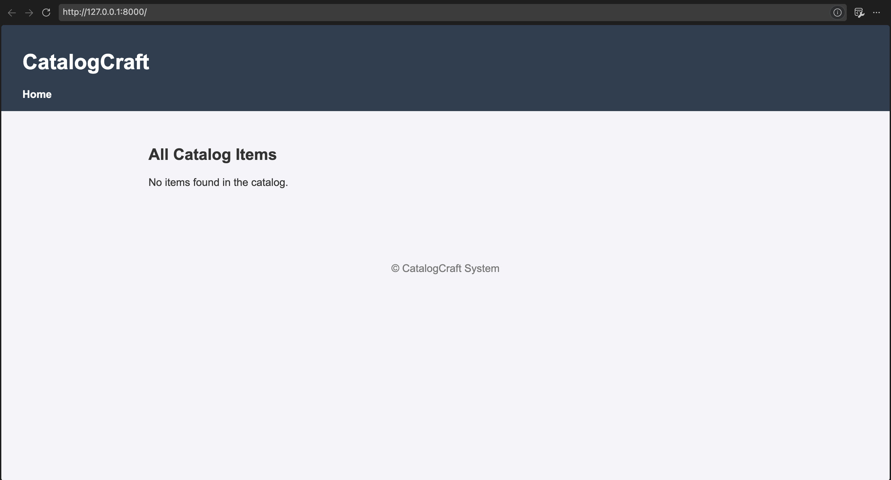
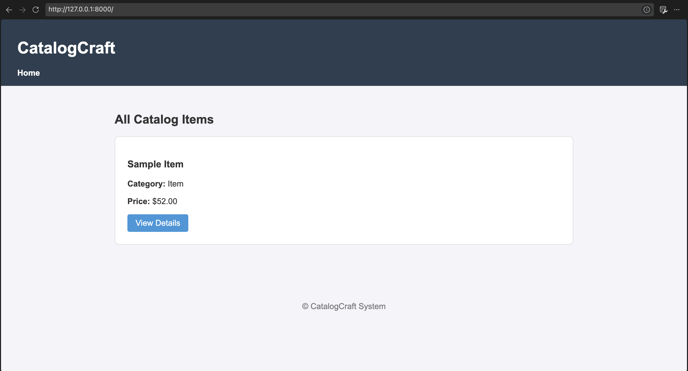
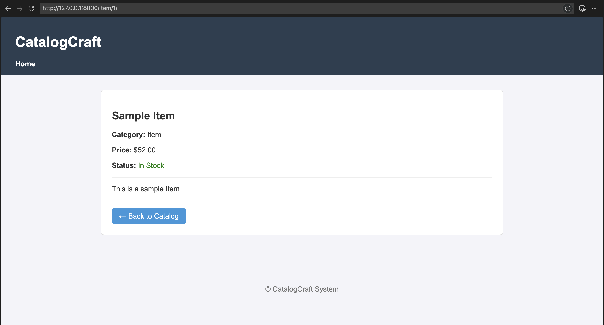
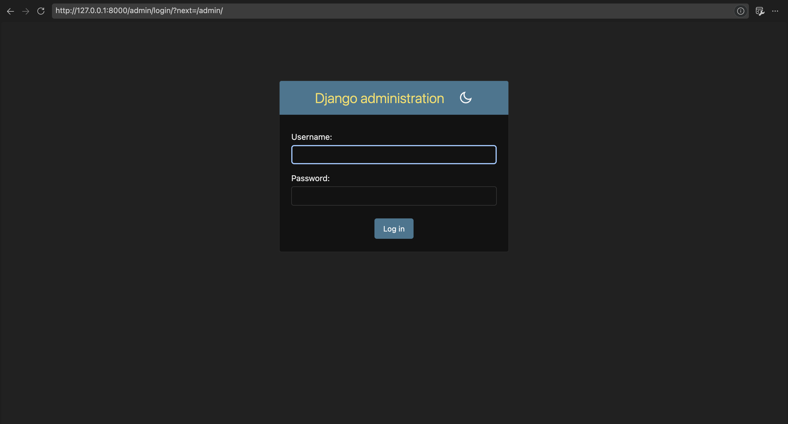
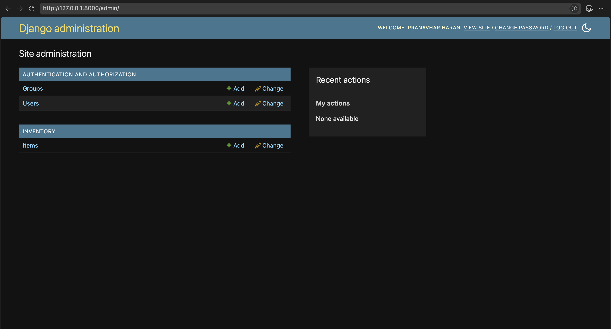
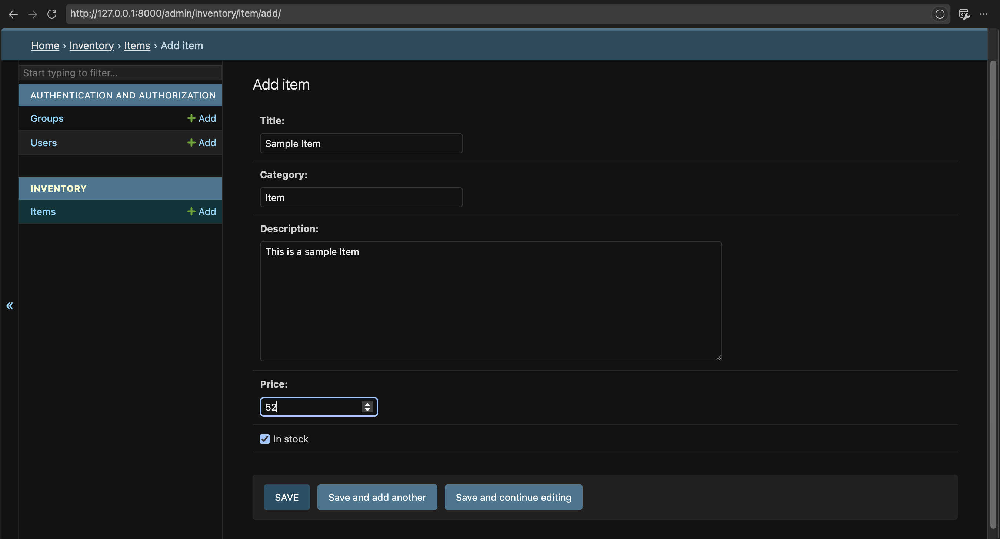
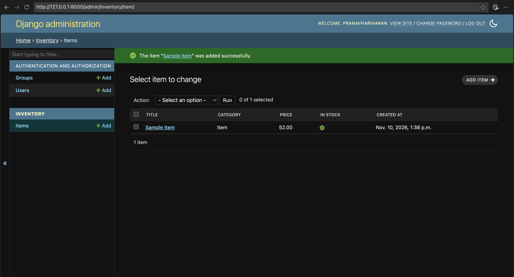

# CatalogCraft

**CatalogCraft** is a lightweight, data-driven web application built with Python and Django. It demonstrates core web development concepts including template inheritance, view routing, ORM data modeling, and custom administration integration.

---

## 🌟 Key Features

- **Base Template Inheritance:** Structured layouts built using a master template (`base.html`) for consistency across pages.
- **Dynamic Catalog View:** Displays all catalog items dynamically populated from the database.
- **Detailed Item View:** Individual detail pages for items with rich context data (price, stock status, category, description).
- **Admin Dashboard Integration:** Built-in Django administrative panel to add, edit, and manage catalog data easily.
- **Responsive Layout:** Clean CSS styling designed for both list and detail views.

---

## 🛠️ Tech Stack

- **Backend:** Python 3.x, Django 5.x
- **Database:** SQLite3 (Default Django DB)
- **Frontend:** HTML5, CSS3, Django Template Language (DTL)

---

## 📸 Screenshots & Workflow

### 1. Catalog List Page (Empty State vs. Active Items)
The project handles dynamic list rendering cleanly:

| Catalog View (No Data) | Catalog View (Populated) |
| :---: | :---: |
|  |  |

---

### 2. Item Detail View
Clicking **View Details** routes to an individual item detail page powered by Django dynamic URLs:



---

### 3. Django Admin Integration & Data Entry
Superusers can add, modify, or remove catalog records seamlessly through the customized admin interface:

| Admin Login | Admin Dashboard |
| :---: | :---: |
|  |  |

| Add New Item Form | Item Management List |
| :---: | :---: |
|  |  |

---

## 📁 Project Structure

```text
catalogcraft/
│
├── catalogcraft/          # Project settings & root URL routing
│   ├── __init__.py
│   ├── settings.py
│   ├── urls.py
│   └── wsgi.py
│
├── inventory/             # Primary Application
│   ├── migrations/
│   ├── templates/
│   │   └── inventory/
│   │       ├── base.html
│   │       ├── item_list.html
│   │       └── item_detail.html
│   ├── admin.py
│   ├── apps.py
│   ├── models.py
│   ├── views.py
│   └── urls.py
│
├── manage.py
└── README.md
```

---

## 🚀 Quick Start Guide

### Prerequisites
Make sure you have Python installed on your system:
```bash
python --version
```

### 1. Clone the Repository
```bash
git clone https://github.com/your-username/catalogcraft.git
cd catalogcraft
```

### 2. Set Up Virtual Environment (Recommended)
```bash
python -m venv env

# On Windows:
env\Scripts\activate

# On macOS/Linux:
source env/bin/activate
```

### 3. Install Dependencies
```bash
pip install django
```

### 4. Run Database Migrations
```bash
python manage.py makemigrations
python manage.py migrate
```

### 5. Create Admin Superuser
To log into the Django Admin dashboard and add initial items:
```bash
python manage.py createsuperuser
```

### 6. Run the Development Server
```bash
python manage.py runserver
```

Open your browser and navigate to:
- **Catalog App:** `http://127.0.0.1:8000/`
- **Admin Portal:** `http://127.0.0.1:8000/admin/`

---

## 📝 License

This project is open-source and available under the [MIT License](LICENSE).